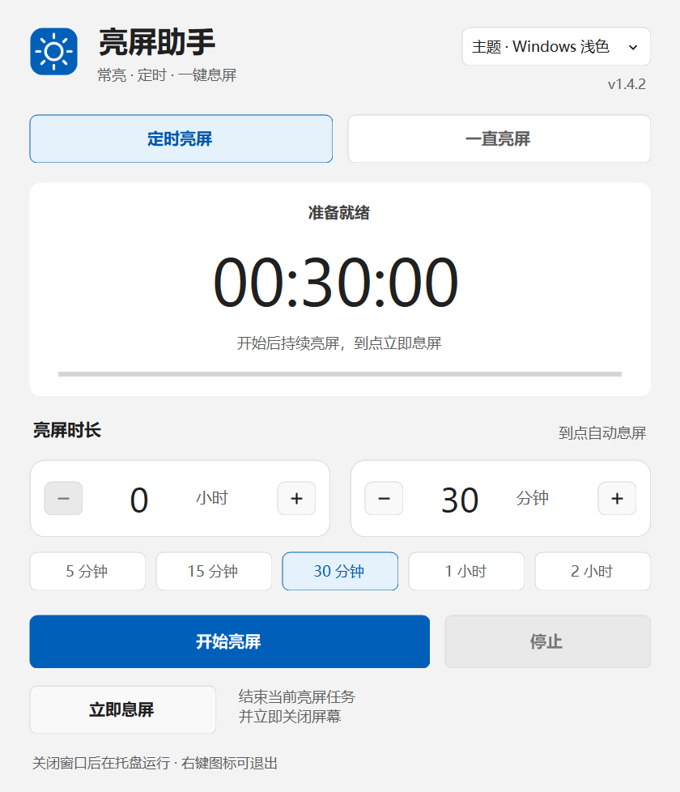
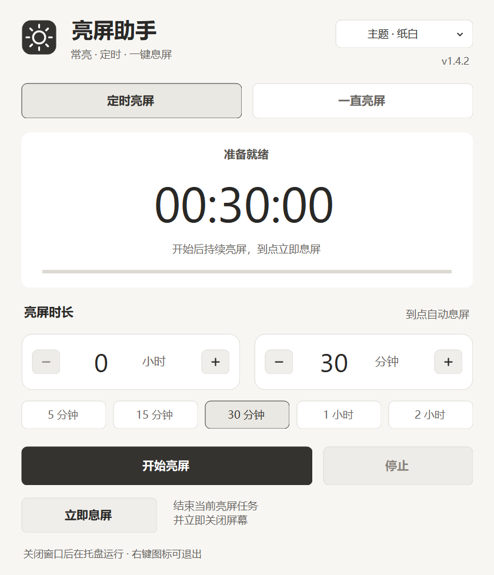
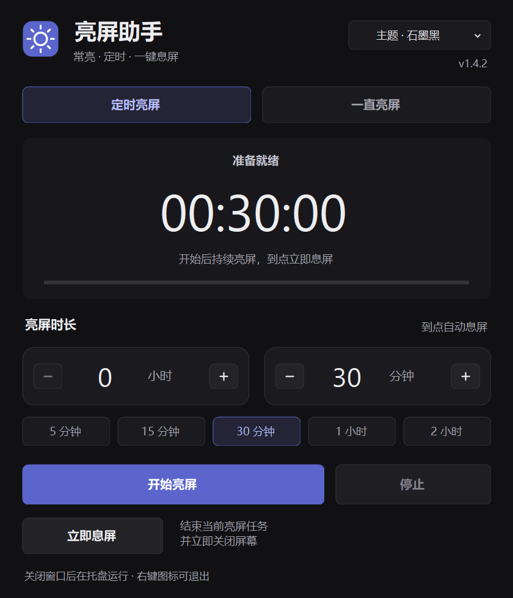

# StayLit · 亮屏助手

轻量的 Windows 托盘工具：按需保持亮屏，倒计时结束立即息屏，也能一键关闭屏幕。支持常亮计时、本地记录和三种主题。

[下载最新版本](https://github.com/perpetualDhyana/StayLit/releases/latest) · [使用说明](USAGE.md) · [更新记录](CHANGELOG.md) · [问题反馈](https://github.com/perpetualDhyana/StayLit/issues)



## 功能

- **定时亮屏**：自定义小时、分钟，提供 5 / 15 / 30 分钟、1 / 2 小时预设；倒计时结束后发送息屏指令。
- **一直亮屏**：持续请求屏幕保持亮起，实时显示本次常亮时长。
- **最近一次记录**：保存常亮任务的时长和开始、结束时间，重启后仍可查看。
- **立即息屏**：无需先开始任务，结束当前任务后即可发送息屏指令。
- **托盘运行**：关闭或最小化窗口后继续运行，右键托盘图标可操作和退出。
- **三套主题**：Windows 浅色、纸白、石墨黑，切换后立即生效并保存；默认 Windows 浅色。
- **本地运行**：无需安装或管理员权限，不联网，不修改电源计划。

## 下载和使用

1. 打开 [Releases](https://github.com/perpetualDhyana/StayLit/releases/latest)，下载 `StayLit-1.4.2-win.zip`。页面中的 `Source code` 为源码，不是可运行程序。
2. 解压后双击 `StayLit-1.4.2.exe`。需要 Windows 10 / 11 和 .NET Framework 4.8 或更高版本。
3. 选择模式，设置时长，点击“开始亮屏”。“停止”交还系统控制，“立即息屏”结束任务并发送息屏指令。

更新前请先从旧版托盘菜单选择“退出”，再打开新版。点击窗口关闭按钮会隐藏到托盘。

小时范围为 0–99，分钟为 0–59。支持键盘输入、上下键、加减按钮。运行期间修改模式或时长后，点击主按钮应用；主题切换直接生效。

每个发布包包含程序、使用说明和许可证。`SHA256SUMS.txt` 提供程序及压缩包的校验值，可用 PowerShell 核对：

```powershell
Get-FileHash .\StayLit-1.4.2-win.zip -Algorithm SHA256
```

## 主题

| Windows 浅色 | 纸白 | 石墨黑 |
| --- | --- | --- |
|  |  |  |

标题栏由 Windows 绘制，外观取决于系统支持情况。

## 记录和设置

常亮记录表示任务经过的时间，包含任务运行期间的手动锁屏或睡眠间隔，并非显示器硬件实际发光时长。

当前只保留最近一次记录。停止、息屏、切换为定时模式或退出后保存记录；再次开始常亮会从零计时。运行中每分钟保存一次快照，正常结束时保存最终记录。应用重启后需要手动开始任务。

设置和记录保存在 `%LOCALAPPDATA%\StayLit\settings.xml`。已手动选择的主题会保留。退出后删除程序即可停止使用，设置文件可按需删除。

## 运行边界

- 息屏只执行一次，之后移动鼠标或按键可以正常亮屏；其他软件也可能唤醒屏幕。
- 息屏命令作用于 Windows 连接的显示器，不单独控制某块显示器，不改变亮度，也不包含定时重新亮屏。
- 手动锁屏、合盖、电源键、手动睡眠和组织策略仍由 Windows 决定，应用不绕过这些规则。
- 到点每 250 毫秒检查一次，系统负载、驱动和显示器处理命令可能产生短暂延迟。

## 从源码构建

需要 Windows 和 .NET Framework 4.8。使用 Windows 自带的 .NET Framework C# 编译器，不下载第三方运行依赖，也不需要 .NET SDK。

在项目目录运行：

```powershell
powershell -NoProfile -ExecutionPolicy Bypass -File .\build.ps1 -Test
```

输出：

- `dist/StayLit-1.4.2.exe`
- `dist/StayLit-1.4.2-win.zip`
- `dist/SHA256SUMS.txt`
- `build/test-report.txt`

当前有 33 项自动检查，覆盖计时、电源调用顺序、取消、立即息屏、常亮记录、设置兼容、主题切换、输入校验和模拟显示恢复后的重绘。

自动检查使用模拟电源，不会实际关闭显示器，不能替代真实硬件的息屏唤醒验证。已检查本机 150% 显示缩放下的三套主题。仓库提供 Windows 构建检查工作流。

可生成安全预览，不读取或保存用户设置：

```powershell
.\dist\StayLit-1.4.2.exe --preview .\build\preview.png timed WindowsLight
```

状态可选 `idle`、`timed`、`off`、`focus`、`always-ready`、`always`、`always-stopped`、`always-off`、`always-long`；主题可选 `WindowsLight`、`Paper`、`Graphite`。预览中的时间和记录为示例数据。

## 实现和贡献

使用 C#、.NET Framework WinForms 和 Windows API：

- [SetThreadExecutionState](https://learn.microsoft.com/en-us/windows/win32/api/winbase/nf-winbase-setthreadexecutionstate)：运行时申请显示器和系统保持活动，在同一 UI 线程释放。
- [WM_SYSCOMMAND / SC_MONITORPOWER](https://learn.microsoft.com/en-us/windows/win32/menurc/wm-syscommand)：释放常亮请求后，向应用自身窗口发送息屏命令。

计时使用单调计时器，系统日期时间调整不改变倒计时。欢迎提交 Issue 或 Pull Request，详见 [贡献指南](CONTRIBUTING.md)。

## 许可证

[MIT](LICENSE) © 2026 [perpetualDhyana](https://github.com/perpetualDhyana)。
